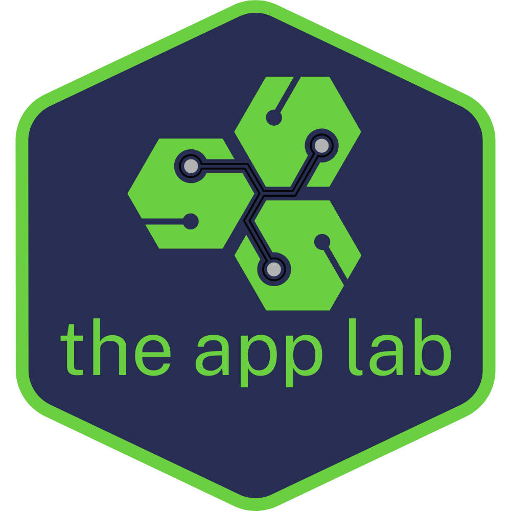
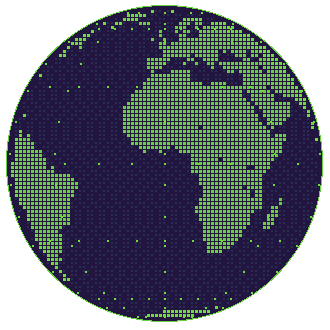

<div align="center">
  <a href="https://theapplab.co.za">
    
  </a>

  # `KWEKUQ@GITHUB:~$`

  **SOFTWARE DEVELOPER // ENTREPRENEUR**

  `CUSTOM SOFTWARE` • `CLOUD SOLUTIONS` • `INTELLIGENT SYSTEMS`

  [Website](https://theapplab.co.za) &nbsp;·&nbsp; [GitHub](https://github.com/kwekuq) &nbsp;·&nbsp; [LinkedIn](https://www.linkedin.com/in/kwekuq/) &nbsp;·&nbsp; [Email](mailto:hello@theapplab.co.za)
</div>

---

## `00 / system.boot`

<table>
  <tr>
    <td width="66%" valign="top">
      <pre><code>C:\DEV\KWEKUQ&gt; WHOAMI
------------------------------
USER     : KwekuQ
ROLE     : Developer / Entrepreneur
COMPANY  : The App Lab
MISSION  : Build dependable digital products
FOCUS    : Software / Cloud / AI
STATUS   : [ ONLINE ]
------------------------------
C:\DEV\KWEKUQ&gt; _</code></pre>
    </td>
    <td width="34%" align="center" valign="middle">
      
      <br />
      <code>[ EARTH.EXE // LIVE ]</code>
    </td>
  </tr>
</table>

## `01 / about.ts`

```ts
const kwekuq = {
  role: ["software developer", "entrepreneur"],
  company: "The App Lab",
  interests: [
    "custom software",
    "cloud solutions",
    "AI & analytics",
    "workflow automation",
  ],
  buildWith: ["Python", "Django", "React", "TypeScript", "AWS"],
} as const;
```

I enjoy taking ideas from architecture through implementation and delivery. At [The App Lab](https://theapplab.co.za), the work centres on practical software and intelligent systems for organisations with real problems to solve.

## `02 / tech.stack --list`

| Directory | Technologies |
| :--- | :--- |
| `~/languages` | `Python` `JavaScript` `TypeScript` `HTML` `CSS` |
| `~/frontend` | `React` `Next.js` `Tailwind CSS` |
| `~/backend` | `Django` `Node.js` `Express` |
| `~/databases` | `PostgreSQL` `MongoDB` `Redis` |
| `~/cloud` | `AWS` `Docker` `Linux` `Nginx` |
| `~/tooling` | `Git` `GitHub` `Terraform` |

## `03 / work --focus`

```text
$ cat focus.txt

[01] CUSTOM SOFTWARE     Web apps, portals, dashboards and internal tools
[02] CLOUD SOLUTIONS     AWS architecture, deployment and infrastructure
[03] INTELLIGENT SYSTEMS  AI-enabled applications and useful automation

$ echo "Custom software. Intelligent systems. Measurable impact."
Custom software. Intelligent systems. Measurable impact.
```

**Selected work:** [Explore The App Lab client projects](https://theapplab.co.za/clients)

## `04 / github --activity`
| Command | Destination |
| :--- | :--- |
| `git log --oneline` | [Public contributions](https://github.com/kwekuq?tab=overview) |
| `ls ~/repositories` | [Repositories](https://github.com/kwekuq?tab=repositories) |
| `gh api users/kwekuq` | [Public GitHub profile](https://github.com/kwekuq) |

## `05 / contact --open`

```text
kwekuq@github:~$ ./connect.sh

[ WEB  ] theapplab.co.za
[ MAIL ] hello@theapplab.co.za
[ LINK ] linkedin.com/in/kwekuq
[ BLOG ] medium.com/@kwekuq
[ DEV  ] dev.to/kwekuq
```

**[Start a project](mailto:hello@theapplab.co.za)** · **[Explore The App Lab](https://theapplab.co.za)** · [LinkedIn](https://www.linkedin.com/in/kwekuq/) · [Medium](https://medium.com/@kwekuq) · [DEV](https://dev.to/kwekuq)

---

<div align="center">

`kwekuq@github:~$` **BUILD. SHIP. IMPROVE.** `█`

</div>
